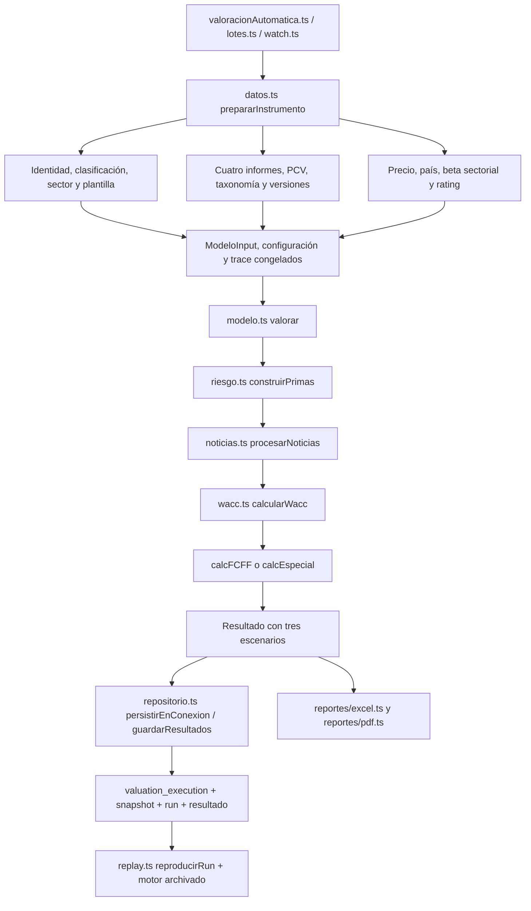

# Auditoría del motor existente — 29/10/2026

Auditoría estática del repositorio, anterior a la implementación del módulo. No se han ejecutado importadores, consultas de escritura, migraciones ni valoraciones reales. Las rutas son relativas a la raíz G2EXCHANGE. El esquema observado es el fichero SQL, no una certificación de la instancia MySQL desplegada. Los documentos del usuario ya modificados al inicio quedan fuera de esta intervención.

## Mapa del proceso actual

El módulo propuesto no se inserta en ninguna flecha. En particular, añadir archivos a `valuation_engine/src` cambiaría el manifiesto del motor: `scripts/manifest.cjs:current` incluye todos sus `.ts` y los `.js` de `dist/src`. Por ello se implementa fuera de `src`, `config`, `generator` y los builds existentes, con compilación propia y sin imports desde producción.

## Archivos, funciones y fórmulas comprobadas

| Proceso | Archivo / función | Comportamiento real |
|---|---|---|
| Preparación de entrada | `server/src/valoracion/datos.ts:prepararInstrumento` | País US/JP/TW, moneda del instrumento, cuatro cierres anuales consecutivos, PCV normalizados y versiones. Divide cantidades contables y acciones entre 1e6. No hace FX implícito. |
| Normalización | mismo archivo, `normalizarPartidas` | EBITDA=EBIT+D&A; deuda total=deuda CP+LP; NWC=inventarios+cobrar−pagar; FCF=CFO−CAPEX. Valida alias/signos y ambigüedades. No equivale a una auditoría contractual de toda la deuda. |
| KPI de informe | `server/insercionDatos/insercionKPIInformeFinanciero.ts:kpiCalcularInforme`; `insercionDatosKPIFinancieroInforme.ts:calcularYGuardarKpis`; `server/scripts/pcv-prerrequisitos-kpi.cjs:filtrarKpiCalculables/instalarRequisitos` | Función numérica dentro de archivo que importa conexión y operaciones HTTP/BD. Cobertura=EBIT/abs(intereses), FCF=CFO−abs(CAPEX), EBITDA=EBIT+abs(D&A). La política de prerrequisitos exige ambos componentes de deuda; no asumir que todo KPI heredado pasó esa política. Reutilizar observaciones verificadas, no importar su escritor al módulo aislado. |
| Sector y maestro | `mapeoSectores.ts:obtenerMapeoSector/obtenerPlantillaPorSector`; `motorServicio.ts:resolverConfiguracionFinanciera` | Correspondencias ID MySQL → códigos 01–16, estados DIRECTA/GENERAL/REVISAR. REVISAR bloquea selección automática. `classification_evidence` puede aportar clasificación aceptada de confianza alta. |
| Beta | `server/insercionDatos/insercionDatosSector.ts:descargarBetasPorSector`; `betaSectorial.ts/.cjs:calcularBetaPonderada/agruparBetasPorSector` | Descarga `betaGlobal.xls`, columna `Beta` (apalancada). Agrega industrias por número de empresas, no por capitalización. Hay aproximaciones sectoriales y Total Market para N/A. Guarda `sector.sensibilidad_al_mercado`. |
| Selección de beta | `datos.ts:prepararInstrumento` | Lee la beta sectorial actual; admite override `hip.sector_beta` con fuente/fecha. No estima beta individual, no desapalanca ni reapalanca a D/E de la empresa. El apalancamiento medio de comparables está implícito en esa beta. |
| ERP y país | `server/insercionDatos/insercionDatosPais.ts:insertarPrimaRiesgoMercado`; `datos.ts:prepararInstrumento` | Importa **Total Equity Risk Premium** de Damodaran, multiplica por 100 para MySQL y divide por 100 al construir entrada. Incluye componente país. `riesgo_extra_por_pais` no se añade al CAPM. Comprobar origen de cualquier override/importación heredada. |
| Referencia CAPM | `server/insercionDatos/actualizarCosteCapitalReferencia.ts:actualizarCosteCapitalReferencia` | UPDATE de referencia: `ROUND((p.interes_bono_10_ano+s.sensibilidad_al_mercado*p.prima_riesgo_mercado)/100,4)`. Ke decimal; ERP copiado en puntos porcentuales. **No ejecutado**. |
| Ke efectivo | `valuation_engine/src/wacc.ts:calcularWacc` | `Ke=Rf+sector_beta*ERP`, decimal anual, igual en los tres escenarios. No toma el Ke redondeado de la tabla referencia como tasa final. |
| Rating / insolvencia | `datos.ts:resolverRating`; `evidencia.ts:perfilPorCapitalizacion`; `automatizacionRatingSintetico.ts:sincronizarSpreadsRating/calcularRatingSintetico` | Cobertura `EBIT/abs(intereses)`; intereses cero bloquean. Selecciona fila activa por intervalo, perfil y fecha mercado. Puede usar cobertura de un informe anterior si FY0 no la contiene, con advertencia. Spreads base/optimista/pesimista. |
| Tamaño ya en deuda | `evidencia.ts:perfilPorCapitalizacion` | Política heredada US/USD: >5.000 millones → GRANDE_NO_FINANCIERA, < → PEQUEÑA_RIESGOSA; igualdad no resuelta. BANK/INSURANCE → FINANCIERA. No trasladar ese umbral a nuevas primas. JP/TW requieren evidencia de perfil. |
| Kd | `wacc.ts:calcularWacc` | `Kd_s=Rf+spread_s`. `Kd_neto=Kd_s*(1−T)`. T de país. No valida capacidad efectiva de utilizar el escudo fiscal. |
| E, D y pesos | misma función | `E=price_per_share*diluted_shares`; D=`gross_debt_fy0`; `wE=E/(E+D)`; `wD=D/(E+D)`. E y D en millones de la misma moneda. D es deuda financiera bruta contable, no deuda neta ni valor de mercado de deuda. |
| WACC financiero | misma función | `Ke*wE+Kd*(1−T)*wD`. |
| Primas actuales | `riesgo.ts:construirPrimas`; `config/risk_policy_v15.json` | Manual con evidencia MANUAL_APPROVED/SIMULATION_ONLY, política DRAFT o SYSTEM_DEFAULT_ZERO. Factores `prima_iliquidez`, `prima_tamano`, concentración, otros. DRAFT convierte tramos de capitalización y volumen en primas no calibradas. Multiplicadores por escenario. |
| WACC final actual | `wacc.ts:calcularWacc` | `wacc_ajustado=wacc_financiero+Σ ajustes`. Acepta valores negativos manuales dentro de límites, sin comprobar que la referencia contenga ese riesgo ni aislar duplicidades. No pondera las primas por su componente económico. |
| Noticias | `noticias.ts:procesarNoticias` | Aprobaciones/mapeo, modifica ajustes de WACC o hipótesis de crecimiento/CAPEX/dilución; altera el denominador de acciones antes de WACC. Revisar solapamiento con riesgos del nuevo módulo. |
| Proyección FCFF | `modelo.ts:calcFCFF`; `proyecciones.ts:analizarCrecimiento` | Cinco años. `FCFF_y=Revenue_y*[EBITMargin_y*(1−T_y)+DA_ratio−CAPEX_ratio_y]−ΔNWC_y`. Crecimiento, márgenes, CAPEX y fiscalidad convergen con reglas/históricos/configuración sectorial. Hay soporte TTM. No son estimaciones nuevas de esta fase. |
| Descuento FCFF | `modelo.ts:calcFCFF` | `Σ FCFF_y/(1+WACC_ajustado)^e`, e=y o y−0,5 si MID_YEAR. |
| Terminal | misma función | g=min(límite de entrada, terminal sectorial). Si ROIC terminal documentado válido: `TV=NOPAT_6*(1−g/ROIC)/(WACC−g)`. Si no: `TV=FCFF_5*(1+g)/(WACC−g)`, marcado LEGACY_FCFF/REVIEW. Requiere WACC>g. TV se descuenta a año 5 incluso con MID_YEAR. |
| EV → equity | misma función | `EV=PV(FCFF)+TV/(1+WACC)^5`; `Equity=EV−gross_debt_fy0+cash_fy0−minority_interest`; precio=max(0,Equity/acciones). No separa explícitamente caja operativa, restringida y excedentaria. No concede prima nueva por caja neta. |
| Escenarios | misma función + `wacc.ts` | CONSERVATIVE/BASE/OPTIMISTIC: spreads distintos; crecimiento ±3,5 pp y margen ±2,5 pp en ramas de proyección; márgenes de seguridad 30/25/20%. Son reglas existentes, no parámetros recomendados. |
| Familias especiales | `modelo.ts:calcEspecial/valorar` | Códigos 13/14 DDM: `D1/(Ke+prima_total−g)`; 15 AFFO: `AFFO0*(1+g)/(Ke+prima_total−g)`. WACC informativo. Faltan datos específicos → BLOCKED. RESOURCE/PHARMA siguen rama FCFF, no un modelo académico especial por el nombre de familia. |
| Excel | `src/reportes/excel.ts:escribirExcel` | Selecciona Template_XX; alimenta control/raw/07_WACC; congela resultados TS en 10/11 y crea 14_MOTOR_TS. Hojas 08/09 conservan fórmulas heredadas de contraste. `model_version` visible aún 1.5.0 frente a motor 1.5.1: documentar consistencia futura. |
| PDF | `src/reportes/pdf.ts:escribirPdf` | PDF propio de una página con resultados TS y tabla de primas; no recalcula DCF. |
| Versiones / persistencia | `repositorio.ts:persistirEnConexion/guardarResultados`; `rutas.ts:manifiestoMotor/cargarMotorHistorico`; `replay.ts:reproducirRun`; `mysql_readonly.ts:exportarInputDesdeRun` | Input/trace/output congelados en valuation_execution, hashes y motor archivado. No sobreescribe resultados existentes. Un run sin input congelado no se reconstruye con datos actuales. |
| Parámetros opcionales | `src/integracion/mysql_persist_optin.ts:persistirParametrosAprobados` | Escritor separado, opt-in, exige columnas adicionales, run PREPARANDO y ausencia de parámetros. No es la ruta habitual de repositorio, que conserva el JSON. No invocarlo en esta fase. |

## Hallazgos que requieren una fase aprobada

1. **Primas arbitrarias heredadas y ubicación financiera:** la política DRAFT reconoce que no está calibrada. La etiqueta REVIEW no cambia que sus cifras entran en el resultado de esa rama. Sustituir su tratamiento requeriría un cambio del motor, no realizado aquí. El nuevo módulo no importa esta política.
2. **Doble apalancamiento / incoherencia:** beta sectorial apalancada + pesos de deuda propios no equivalen a reapalancar beta. Preparar un futuro proceso de beta desapalancada comparable y apalancamiento objetivo coherente; no corregir automáticamente históricos.
3. **Riesgo país:** el ERP total ya lo contiene. Además, Rf procede de bonos soberanos locales: verificar si contienen spread soberano y si deben depurarse. La metodología actual de Damodaran distingue tasa libre de default de rendimiento soberano. No sumar CRP otra vez. [Fuente metodológica](https://pages.stern.nyu.edu/~adamodar/New_Home_Page/datafile/ctryprem.html).
4. **Historia de referencias:** país y sector son filas mutables; `coste_capital_referencia` tiene UNIQUE(sector_id,pais_id), no una serie histórica. Fechas de descarga no prueban fecha de publicación del dato. Consultar <=asOf no recupera automáticamente valores antiguos sobreescritos. El JSON congelado y el archivo del motor sí permiten replay de runs congelados.
5. **Cotizaciones:** UNIQUE(instrumento_id), sin volumen. El recuperador actualiza precio en conflicto sin actualizar fecha. No hay serie diaria garantizada y existe riesgo de precio nuevo con fecha antigua. No es posible estimar retornos/Amihud/beta individual desde esa tabla tal como está definida. No se cambia.
6. **Acciones y moneda:** `ACCIONES_EN_CIRCULACION` se pasa como `diluted_shares` proxy; faltan prueba de dilución, clases, ADR, splits y alineación temporal. Las cantidades se dividen por 1e6 bajo convención de unidades original; la propia entrada advierte que requieren verificación.
7. **Caja:** añadir toda la caja al equity no demuestra que toda sea excedentaria. Evitar reducir Ke por esa misma caja. Futura conciliación de caja operativa/restringida/no operativa y activos no operativos.
8. **Escudo fiscal y modelos financieros:** T de país puede diferir de capacidad fiscal. Bancos/seguros no deben pasar por ratios de liquidez industrial o deuda/EBITDA para estimar WACC; conservar metodología propia. REIT AFFO usa Ke, no FCFF.
9. **Desconocido vs cero:** `primasCero` usa fecha fija 2026-10-12 y marca hipótesis sin estimación auditada. No representa evidencia de riesgo neutral. La nueva API conserva null cuando no estima.
10. **Evidencia manual:** fuente y fecha con formato válido no prueban aplicabilidad, calibración o ausencia de información futura en todas las ramas. Los ajustes de `construirPrimas` validan formato, fuente y rango, pero no hacen una revisión financiera de coeficientes ni de baseline. No reutilizar la etiqueta MANUAL_APPROVED como evidencia académica suficiente.

Estos hallazgos son propuestas; ninguna fórmula, tabla, recuperador o plantilla ha sido corregida en esta intervención.
